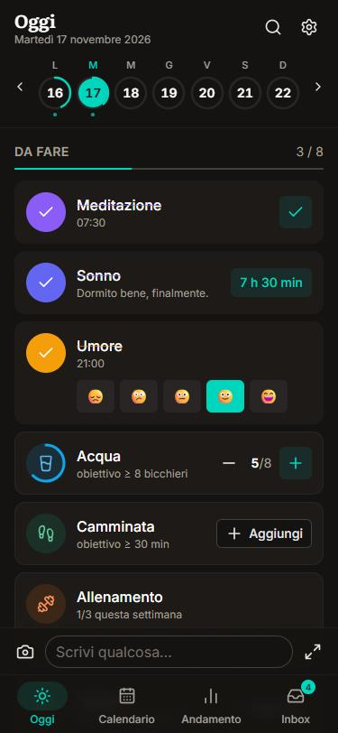

# Reminder

Un diario quotidiano configurabile, installabile come app sul telefono e utilizzabile anche offline.

Decidi tu cosa tenere d'occhio: abitudini, misure, faccende, umore. Ogni giorno Reminder ti mostra cosa c'è da fare e cosa hai già registrato. Accanto alle attività c'è un diario per pensieri, fatti e foto. Tutto resta sul tuo dispositivo, senza account.

<p align="center"></p>

## Cosa puoi farci

- **Attività configurabili**, ognuna con un colore (38 della palette o uno personalizzato), una delle oltre 200 icone divise per categoria e il suo tipo di valore:
  - fatto/non fatto;
  - contatore;
  - numero con unità;
  - durata;
  - scala (es. umore con emoji);
  - scelta tra opzioni;
  - testo.
- **Ricorrenze vere**: ogni giorno, alcuni giorni della settimana, N volte a settimana, ogni N giorni, una volta al mese, oppure "quando capita".
- **Obiettivi** come "almeno 8 bicchieri" o "al massimo 2 caffè", con un anello di avanzamento.
- **Vista Oggi**: le attività previste, registrabili in uno o due tap, i promemoria dell'inbox e il diario del giorno. In fondo c'è un campo per scrivere una nota al volo.
- **Diario** con più voci al giorno, ognuna con orario, tag e **foto**. Le foto vengono compresse sul dispositivo prima di essere salvate.
- **Inbox** per le cose da fare senza data. Con una data compaiono anche nella vista di quel giorno; completate diventano voci del diario. Si gestiscono con uno swipe.
- **Calendario** mensile con l'anello di completamento di ogni giorno e i segni per note e foto.
- **Andamento**:
  - serie attuale e record;
  - percentuale di completamento;
  - mappa annuale;
  - grafico dei valori;
  - distribuzione delle scelte.
- **Ricerca** per testo, attività, tag e periodo.
- **Primo avvio guidato** con pacchetti pronti (Benessere, Casa, Studio e lavoro) e una guida all'installazione.
- **Annulla** al posto di "Sei sicuro?" per le eliminazioni.
- **Badge** sull'icona dell'app con il numero di cose ancora da fare oggi, e una notifica opzionale all'apertura.
- **Backup** JSON (con o senza foto), importazione e reset. L'app importa anche i backup della versione precedente.
- Tema chiaro, scuro o automatico; dimensione del testo regolabile; accessibile da tastiera e da screen reader.

> **Perché niente notifiche a orario?** Senza un server, il browser non permette di programmare notifiche affidabili ad app chiusa. Reminder usa il badge sull'icona e una notifica quando apri l'app.

## Dalla versione precedente

Se sul dispositivo c'erano i dati della vecchia app (Angular), al primo avvio vengono convertiti automaticamente:

- note → voci del diario;
- todo → inbox;
- ricorrenti → attività;
- categorie → tag.

Lo stesso vale importando un vecchio file di backup.

## Sviluppo

Serve Node.js 22 o superiore con pnpm.

```bash
pnpm install
```

```bash
pnpm dev
```

| Comando | Cosa fa |
|---|---|
| `pnpm dev` | Server di sviluppo su http://localhost:3000 |
| `pnpm build` | Build statica in `.output/public` |
| `pnpm test` | Test Vitest (ricorrenze, statistiche, backup e migrazione) |
| `pnpm typecheck` | Controllo dei tipi con vue-tsc |
| `pnpm lint` | ESLint |
| `pnpm icons` | Rigenera le icone PWA da `public/icon.svg` |
| `pnpm build-and-publish` | Build con base `/reminder/` e pubblicazione manuale su GitHub Pages |

### Deploy

Ogni push su `master` avvia il workflow [deploy.yml](.github/workflows/deploy.yml): test, lint, build con base `/reminder/` e pubblicazione sul branch `gh-pages`, da cui GitHub Pages serve https://elpiu.github.io/reminder/. Si può anche lanciare a mano dalla scheda Actions.

Su Windows, se lanci la build a mano da Git Bash con un base path, aggiungi `MSYS_NO_PATHCONV=1`. Altrimenti Git Bash trasforma `/reminder/` in un percorso Windows:

```bash
MSYS_NO_PATHCONV=1 NUXT_APP_BASE_URL=/reminder/ pnpm build
```

## Stack

Nuxt 4 in modalità SPA · Vue 3.5 · TypeScript · Nuxt UI v4 · Tailwind CSS v4 · Dexie (IndexedDB) · @vite-pwa/nuxt · icone Lucide e font Inter/Literata inclusi nel bundle · Vitest · ESLint.

Dettagli e regole in [docs/tecnico.md](docs/tecnico.md); prodotto e funzionalità in [docs/prodotto.md](docs/prodotto.md).

## Gestione del progetto

- I task sono tracciati con [Backlog.md](https://github.com/MrLesk/Backlog.md): `backlog board` mostra la board, `backlog browser` la apre nel browser.
- L'architettura è mappata con [groma.md](https://github.com/MrLesk/groma.md): `groma web` apre la mappa.
